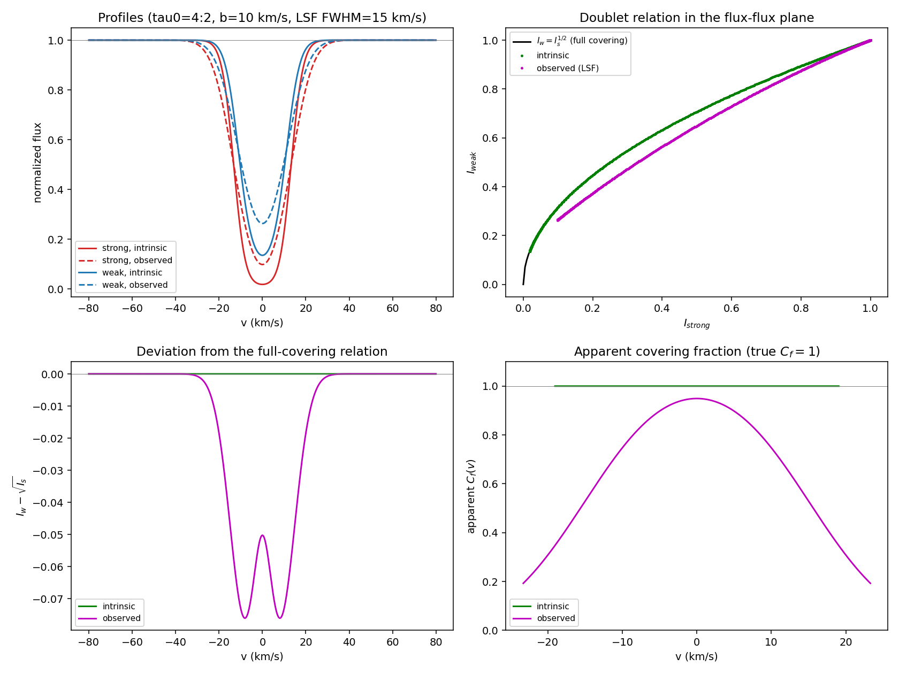
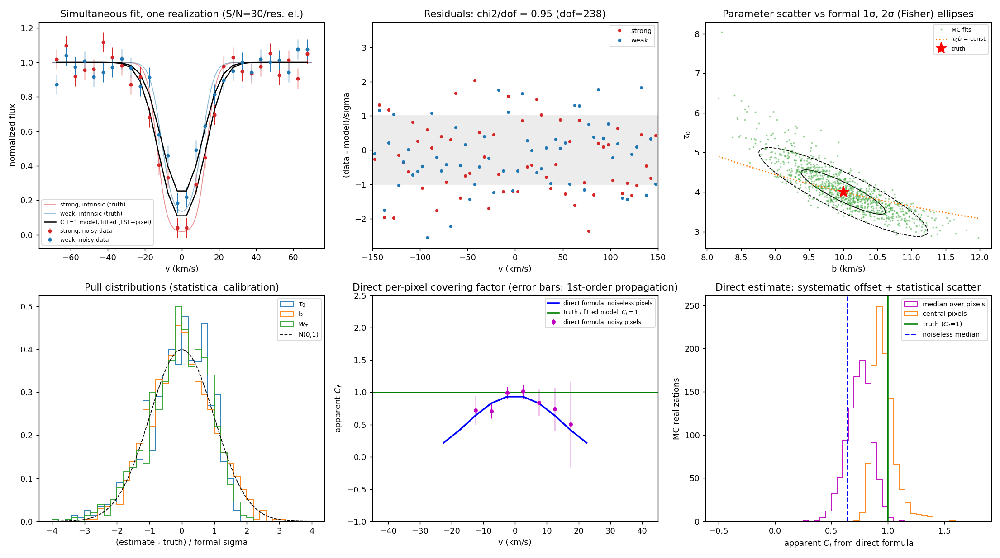

# Evaluating Claude with absorption-line spectroscopy

**Dr. Suraj Poudel — exploratory scientific AI evaluation, October 2026**

Can an AI assistant distinguish physical partial covering from an instrumental effect in absorption doublets? This repository documents an introductory, AI-assisted investigation: questioning Claude about absorption-line inference, auditing its answers, and asking it to generate controlled numerical experiments.

The project began while preparing for an Anthropic STEM fellowship application. It is a learning exercise and reproducible demonstration, not a new scientific discovery, a trained ML model, or a systematic benchmark of Claude.

## What I did

I asked Claude to explain when column-density measurements are reliable and to distinguish observational constraints from model assumptions. With ChatGPT's help, I followed up on numerical errors and overstatements, requested an explicit audit, and asked Claude to test a doublet relation numerically. Claude generated Python scripts, figures, and output, which I brought back to ChatGPT for review. ChatGPT inspected both scripts and independently reran the first experiment. This record does not establish that I independently ran the scripts locally or in Colab.

The work so far used Claude's conversational interface. **It does not establish Claude Code experience.** Prompts and critique were developed with ChatGPT assistance; Claude wrote the original implementations. See [the contribution record](docs/PROVENANCE.md).

## Experiments

### 1. Can instrumental broadening mimic partial covering?

The strong-line optical depth is `tau_s(v) = 4 exp[-(v/10)^2]`; the weak line has half that optical depth. Both fully cover the source. A Gaussian LSF with FWHM 15 km/s smooths the transmitted flux.

Intrinsically, `I_w = sqrt(I_s)`. After averaging flux with the same nonnegative normalized LSF, `I_w,obs <= sqrt(I_s,obs)`. Applying the intrinsic doublet covering-factor formula directly to those smoothed profiles returns an apparent covering fraction below unity even though the input is exactly unity.



| Diagnostic | Result |
|---|---:|
| True covering fraction | 1 |
| Apparent covering fraction at line center | 0.9493 |
| Minimum within a strong-line depth >=10% mask | 0.1927 |
| Equivalent-width changes | Approximately 10^-14 or smaller |

The minimum depends on the mask and occurs near its boundary. It is not a universal error estimate.

### 2. Can a correctly convolved model recover the inputs?

Both lines are fitted jointly, with covering fraction **fixed** to 1. The model convolves flux with the LSF and integrates over detector pixels. Synthetic observations use a finer grid than fitting. Independent Gaussian pixel noise corresponds to continuum S/N=30 per three-pixel resolution element. The script performs 1,000 noise realizations.



| Quantity | Input | Noiseless fit | Noisy MC median |
|---|---:|---:|---:|
| Strong-line peak optical depth | 4 | 3.998639 | 4.003 |
| Doppler parameter (km/s) | 10 | 10.001335 | 9.990 |
| Integrated optical depth (km/s) | 70.8982 | Approximately 70.8835 | 70.853 |

The fixed-covering model explains these synthetic data and recovers optical-depth amplitude and width. **It does not independently measure the covering fraction.** A different grid reduces identical-discretization artifacts but generation and fitting still share the same physical model family.

## Run locally or in Colab

Use Python 3.10+ and install the dependencies:

```bash
python -m pip install -r requirements.txt
python src/doublet_lsf_experiment.py
python src/doublet_fit_experiment.py
```

Both scripts write PNGs to `figures/` and print results. To save console output:

```bash
python src/doublet_lsf_experiment.py > results/doublet_lsf_experiment_rerun.txt
python src/doublet_fit_experiment.py > results/doublet_fit_experiment_rerun.txt
```

For Colab, upload/extract this repository, install the dependencies, change into its directory, and run the same scripts with `!python ...`. No GPU is required. Exact last digits can vary across numerical-library versions.

Original uploaded scripts, including their original environment-specific output paths, are preserved in `archive/`. The runnable copies change only output-path handling. No license was selected on the author's behalf.

## Record and limitations

- [Chronological questions, answers, and reviews](docs/CONVERSATION_RECORD.md)
- [Claude's initial answer](docs/CLAUDE_INITIAL_ANSWER.md)
- [Claude's audit](docs/CLAUDE_AUDIT.md)
- [Claude's first numerical-experiment report](docs/CLAUDE_EXPERIMENT_1_REPORT.md)
- [Full second-experiment console output](results/doublet_fit_experiment_output.txt)
- [Scientific caveats and corrections](docs/SCIENTIFIC_REVIEW.md)
- [Authorship, packaging, and validation record](docs/PROVENANCE.md)

This is a curated record of the project discussion supplied in ChatGPT, not an independently exported Claude transcript. Complete user-pasted scientific answers are preserved in separate files with plain-text formatting normalization. Unavailable Claude messages, tool logs, model versions, and unseen first attempts are not invented. Administrative discussion about plan pricing is summarized rather than treated as scientific evidence.

## Scientific references

- Savage & Sembach (1991), *The analysis of apparent optical depth profiles for interstellar absorption lines*: https://ntrs.nasa.gov/search.jsp?R=19910068997
- VPFIT documentation (thermal Doppler relation): https://people.ast.cam.ac.uk/~rfc/vpfit12.1.pdf

## GitHub upload

Create a repository such as `absorption-doublet-ai-evaluation`. Extract the downloaded ZIP, open the enclosed project folder, and upload its contents so `README.md`, `src/`, `figures/`, `results/`, `docs/`, and `archive/` are at repository root. Keep the original archives if you want complete artifact provenance.
